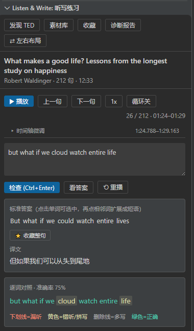
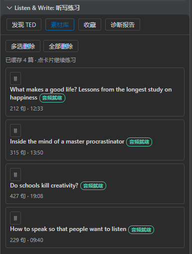
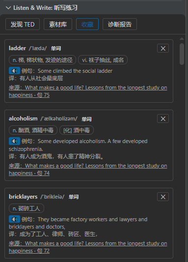
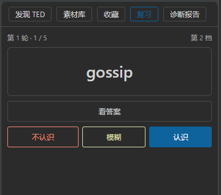
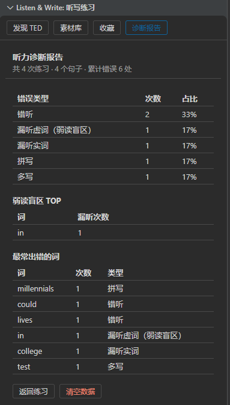

# Listen & Write · 听写英语

一款 VS Code **英语听写插件**：播放 TED 演讲逐句精听，支持拼写检测，针对性提升英语听写能力。

## 功能

- **逐句精听**：按句播放 TED 演讲，自动停在句尾，可循环重播、自动连播、变速（0.5x ~ 1.25x）
- **听写 + 词级 diff**：写下你听到的句子，逐词对比标准答案，区分「漏听 / 错听 / 拼写」
- **听力诊断报告**：长期累积错题，统计出你的弱读盲区（哪些词你总是听不出来）
- **收藏**：在"看答案"面板点选不认识的单词、短语，或收藏整句，随时回看与跳回原句
- **复习**：把收藏的单词做成间隔重复卡片，按 1 / 2 / 4 / 7 / 15 / 30 天的阶梯考你，直到记住
- **发现 TED**：站内搜索 / 浏览 TED 演讲，一键下载（含中英字幕与中文翻译）
- **素材库**：管理已下载的素材，删繁就简
- **中文翻译**：每句自带 TED 官方中文翻译；收藏的单词/短语可接入百度翻译自动查词

## 精听界面

顶部工具栏切换视图：**发现 TED / 素材库 / 收藏 / 复习 / 诊断报告**，另有布局切换按钮（只在精听界面出现）。

精听界面 = 字幕列表 + 练习区：

- **字幕列表**：点击任意句子播放；当前播放句自动定位居中
- **分隔条**：按住列表边的窄条可拖拽调整列表大小，双击恢复默认，单击收起/展开列表
- **播放控制**：`播放/暂停`、`上一句`、`下一句`、倍速循环切换、播放模式三态：
  - **循环关**：播完当前句停
  - **循环开**：当前句反复重播
  - **连播**：播完自动进下一句（纯听模式，不抢输入框焦点）
- **快捷键**（精听界面，输入框聚焦时按键属于输入）：
  `a` 上一句 · `d` 下一句 · `空格` 播放/暂停 · `w` 切播放模式 · `s` 切倍速
- **听写**：在输入框写下听到的句子，`Ctrl+Enter` 或点「检查」看词级 diff
- **看答案**：展开标准答案与中文翻译，并支持点选收藏（见下）

布局可在 **左右布局** 与 **上下布局** 间切换（窄窗口/侧边栏建议上下布局），选择会被记住。

## 发现 TED

站内搜索或浏览 TED 演讲，点「下载」一键抓取（含中英字幕与中文翻译），已下载的直接进入「练习」。

## 素材库

管理已下载的素材：点卡片继续练习，可多选删除或一键全部删除。

## 收藏

在精听界面点 **看答案**：

- **点击单词**选中，**再点相邻的词**扩展成短语，再次点击已选中的词取消
- 有选区时点 **收藏所选**（自动查中文释义）；无选区时点 **收藏整句**（译文来自 TED 字幕，即点即得）
- 收藏整句后按钮变 **已收藏整句（点击取消）**，再点即取消收藏
- 已看过的答案面板在切句、变速、切播放模式后保持打开，再点一次「看答案」收起

顶部导航进入 **收藏** 视图：

- 每条收藏显示词条、释义、**例句及其中译**、来源课程
- **跳回原句**：点击卡片的**「来源」行（带下划线）**，自动进入对应课程的那一句，
  并展开字幕列表、打开"看答案"面板
- ✕ 删除单条
- **🔊 播放例句**：有本地素材的收藏，例句前有 🔊 按钮，点击播放该句对应的音频
  片段，到句尾自动停
- **单词**：内置离线词典（ECDICT，5.7 万高频词）即时给出**音标 + 中文释义**，不需要联网；
  词典未收录的词自动走百度翻译
- **短语 / 整句**：短语译文来自百度翻译；两者中的**每个单词都可以点击**，
  就地展开该词的音标和释义（再点一次收起），整句听写里遇到生词也能随手查
- 多个义项会拆成独立的小标签展示，一目了然
- 未配置百度翻译时，词典查不到的条目标记 ⏳ 待翻译，配置后在收藏视图点
  **更新翻译** 一次性补全（仍然词典优先，只有查不到的才走百度）

### 配置百度翻译（可选）

查词优先级：**离线词典 → 百度翻译**。内置词典覆盖常用词（含音标），整句翻译
来自 TED 官方字幕，两者都不需要配置；百度翻译用于兜底词典未收录的生僻词和短语的整条翻译：

1. 到 [百度翻译开放平台](https://fanyi-api.baidu.com) 注册并实名认证，创建应用
2. 在 VS Code 设置里搜索 `listenAndWrite`，填写：
   - **Baidu App Id**
   - **Baidu Secret**
3. 回到收藏视图，点 **更新翻译** 即可补全所有待译条目

百度标准版免费（每月字符额度 + QPS 1 次/秒），个人学习完全够用。

## 复习

把收藏的**单词**做成卡片，按间隔重复的节奏考你，直到记住。

顶部导航进入 **复习** 视图，点「开始复习」：

- **正面只有单词**：凭第一反应点 **认识 / 模糊 / 不认识**；想不起来就点 **看答案**
- **翻面**展示中文释义、音标、原句及中译、来源课程，以及 **🔊 例句**（播放该词所在句的音频片段）
- **没看答案就点「不认识 / 模糊」**时，卡片会**停在原地自动翻面**——看完答案再点「下一个」继续，
  免得蒙一个就翻页、白考一次

### 间隔阶梯

答对一次，用**当前档位**的间隔排期，然后升一档：

| 档位 | 1 | 2 | 3 | 4 | 5 | 6 |
|---|---|---|---|---|---|---|
| 间隔 | 1 天 | 2 天 | 4 天 | 7 天 | 15 天 | 30 天 |

- **认识**：升一档；已在最后一档再答对 → 判定 **✓ 已掌握**，退出复习池
- **模糊**：档位不变，明天再考一次
- **不认识**：档位归零，明天重来

> 只有**正面直接答对**才升档。重排轮里才想起来的「认识」只排到明天——那是当场短时记忆，不算掌握。

### 一场复习里的轮次

一场复习由若干「轮」组成：

1. **第 1 轮** = 到期卡 + 当天可引入的新词（打散混合）
2. 轮末把需要重看的卡收进**第 2 轮**，还有就再进**第 3 轮**，最多 3 轮
3. 一张卡一场里**最多重看 2 次**：「不认识」排到本轮末尾再看，「模糊」只再出现一次

每轮之间有小结页，点「继续」进入下一轮；全部结束显示本场统计与 24 小时内待复习数。

### 今日任务做完了

首页显示「待复习 0 个」时，主按钮变成 **再来 5 个**——提前复习还没到期的词，
**不占用**每天的新词额度，也不会把没引入过的新词偷偷放进来。

### 收藏列表里的复习状态

收藏视图每条单词会显示离下次复习还有多久；已掌握的词显示 **✓ 已掌握**，
并带一个 **重新加入复习** 按钮（回到第 1 档重新排期，累计复习次数保留）。

## 诊断报告

每一次听写检查的错误都会被记录。诊断报告按「错误类型 × 单词」聚合统计，
找出你**反复听错**的词——那些就是你的弱读盲区。支持清空重置。

## 设置项

| 设置键（`listenAndWrite.` 前缀） | 说明 |
|---|---|
| `proxy` | 访问 TED 用的代理地址，按需填写 |
| `materialsDir` | 素材存放位置（绝对路径）。留空用默认位置；修改后已有素材自动迁移，重载窗口生效。**收藏与诊断报告数据也存放在此目录**，配置为外部目录后卸载重装 / 换机都不会丢 |
| `audioQuality` | 音频质量 low / medium / high（默认 medium，约 8MB / 8 分钟） |
| `concurrency` | 分片下载并发数（默认 6） |
| `autoReplayOnError` | 听写错误时自动重播该句（默认开） |
| `skipIntro` | 裁掉 TED 片头（默认开） |
| `baiduAppId` / `baiduSecret` | 百度翻译凭证，用于收藏的单词/短语查词 |
| `reviewLadder` | 复习间隔阶梯，默认 `1d / 2d / 4d / 7d / 15d / 30d`。写法 `2h` / `1d` / `1w`（不带单位按分钟算）。**长度固定为 6**，改长度不生效；已在排期的词不受修改影响 |
| `reviewNewWordsPerDay` | 复习时每天最多引入多少个「从未复习过」的新词（默认 10）。设为 0 则只复习已排期的词 |
| `reviewRoundSize` | 每轮复习抽取的卡片数上限（默认 20）。注意这是**上限**：新词 + 到期卡不够时就有多少给多少 |
| `reviewMaxRequeue` | 一张卡在一场复习里最多被重新排到后面几次（默认 2） |

> **数据存放位置**：素材、收藏（`favorites.json`）、诊断报告错题记录（`stats/mistakes.jsonl`）
> 与复习进度（`stats/review.json`）都存放在 `materialsDir` 下。留空时位于扩展全局存储目录
> （`globalStorage`）——而该目录会随扩展卸载被删除，所以想保住这些数据，请把 `materialsDir`
> 配置成一个外部目录（如 `D:\ListeningMaterials`）。

## 开源协议

本项目基于 [MIT License](LICENSE) 开源，Copyright (c) 2026 Azusa。